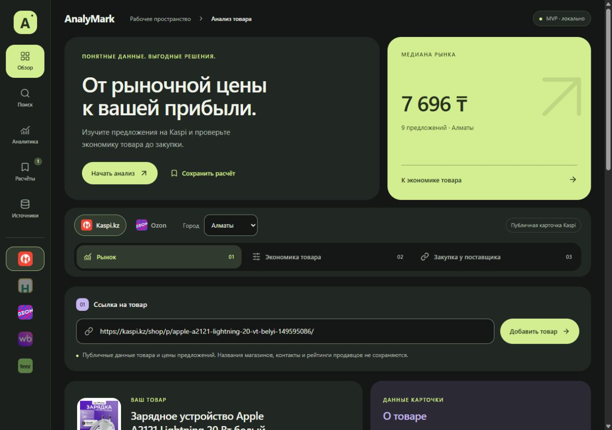
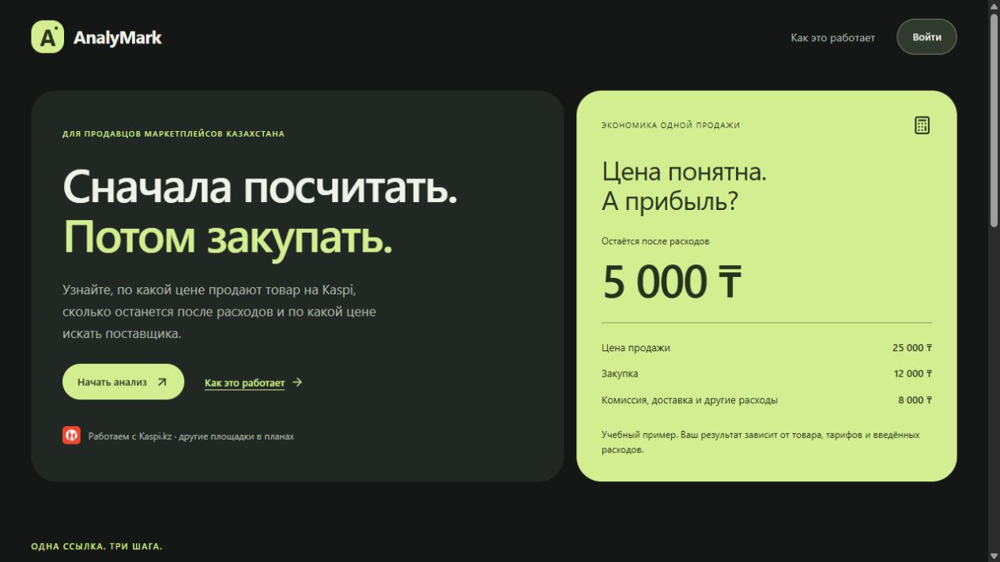
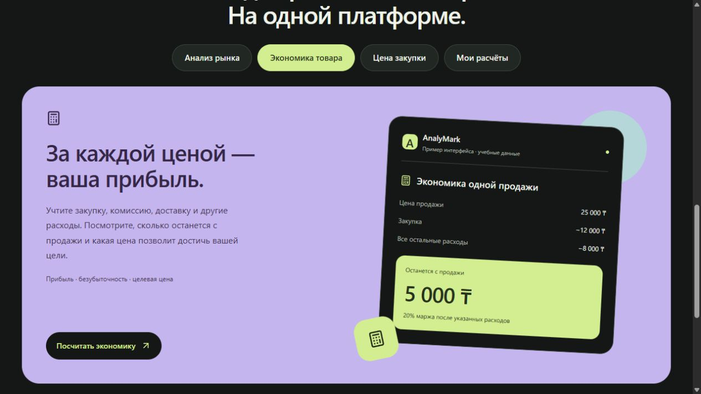

# AnalyMark MVP

Локальное приложение для анализа предложений и экономики товара. Next.js, React, TypeScript; SQLite через встроенный `node:sqlite` (Node.js 24+). Пользовательские данные в `data/analymark.sqlite`, исходные учебные документы не изменены.

## Запуск

```powershell
npm install
npm run dev
```

Открыть http://127.0.0.1:3000. Проверки: `npm test`, `npm run typecheck`, `npm run build`.

## Реализовано

- Kaspi / Ozon, выбор города; смена площадки или города очищает предложения.
- Автозагрузка публичной карточки Kaspi по HTTPS-ссылке: название, фото, характеристики и доступная цена. Для Ozon автозагрузки пока нет.
- Один выбранный товар Kaspi: цены всех предложений продавцов в городе, полные минимум и медиана. Сравнение разных карточек удалено в альтернативном варианте дизайна.
- Экономика успешной продажи, тарифы доставки Kaspi с порогами, ручной тариф для других случаев.
- Максимальная закупочная цена и минимальная цена продажи с поиском по тарифным интервалам.
- Сценарии поставщиков с редактируемыми полными дополнительными расходами.
- SQLite API: сохранение, загрузка и удаление расчётов. CSV-экспорт.
- Методика и прямые ссылки на источники внутри интерфейса.

## Границы модели

Одна единица обычного товара в заказе; продавец без НДС; налог от дохода задаётся вручную. Комиссия с НДС берётся как готовая ставка. Нет автоматического расчёта общего налогового режима, импортных пошлин, объёмного веса, валют, постоянных расходов бизнеса и прогноза продаж. Резерв возвратов задаёт пользователь в тенге на успешную продажу. Неизвестные расходы не должны интерпретироваться как достоверный ноль.

Доставка Kaspi: точные опубликованные суммы без НДС × 1,16 с округлением до тиына. Правила с 01.01.2026, проверка источников 28.10.2026. Шины и другие особые случаи требуют ручного тарифа. Начальные комиссии и налоги — условия примера, не определение категории пользователя. В тарифе комиссии имеется расхождение 10,9% без НДС / 12,5% с НДС; нужна сверка с выпиской продавца.

## Следующие этапы

1. Расширение адаптеров публичных карточек: новые площадки, проверка региональной цены и мониторинг свежести.
2. Подтверждение email, восстановление пароля и подготовка инфраструктуры для внешнего размещения.
3. Реальные коммерческие тарифы поставок и таможенная модель по товару/условиям ввоза.
4. Расширение ИИ: сопоставление товаров с подтверждением человеком. Аудит, SEO и ответы на отзывы реализованы через OpenAI; для активации нужен рабочий ключ.
5. Пилот с продавцами: время задачи, ошибки сопоставления, сверка расходов с заказами, повторное использование.

Аккаунты и сессии хранятся в локальной SQLite. Для production необходим HTTPS: сессионная cookie имеет флаг Secure при NODE_ENV=production. Проверка email, восстановление пароля и OAuth пока не подключены.


## Публичные карточки Kaspi

`POST /api/kaspi/product` принимает `{ "url": "https://kaspi.kz/shop/p/...-ID/", "city": "Алматы" }`.

Парсер Cheerio читает Product JSON-LD, product price meta и строки характеристик из публичного HTML. Скрипты страницы не исполняются. Возвращается строгий набор полей товара: название, ID, каноническая ссылка, фото с resources.cdn-kaspi.kz, бренд, категория, описание, характеристики, доступная цена KZT, запрошенный город и время проверки. Поля продавцов, контакты, профили и рейтинги магазинов не извлекаются и не сохраняются. Полный HTML не сохраняется.

Это цена публичной карточки; она не подтверждена как итоговая цена покупки для города. Профили, названия и контакты продавцов не собираются. Сравниваются только явно добавленные карточки, не весь рынок. Переход «В расчёт» применяет опубликованную цену к калькулятору, а вес, налоги и закупка остаются вводом пользователя.

В SQLite `public_products` хранятся только очищенные снимки. Кэш 15 минут. Интервал между новыми сетевыми запросами — минимум 10 секунд на процесс; timeout 20 секунд, HTML до 4 MB. URL допускает только HTTPS kaspi.kz/shop/p/...-ID/; лишние query-параметры удаляются, перенаправления не выполняются. При ограничении доступа выдаётся ошибка без обхода защиты и без подстановки тестовых цен. Для внешнего размещения потребуются распределённые лимиты и авторизация.

Локальному процессу Node нужен исходящий HTTPS-доступ к kaspi.kz. При запуске в изолированной среде без сети API вернёт понятную ошибку соединения. Токен кабинета и пароль не нужны.

Старые сохранённые расчёты остаются в базе, но устаревшие строки продавцов исключаются из API выдачи. Новые сохранения допускают только очищенные карточки товара.


## Цены предложений на той же карточке

`POST /api/kaspi/prices` принимает ссылку на товар, город и номер страницы (от 0). Используется публичный клиентский источник `/yml/offer-view/offers/{productId}`, найденный в публичном JavaScript карточки. Авторизация и токен кабинета не используются. Это не документированный партнёрский API; при изменении формата или ограничении доступа показывается ошибка.

Из ответа копируются только цена и числовые условия доставки: тип из фиксированного списка, число дней, опубликованный тариф и порог, если они указаны. Merchant ID, названия, контакты, адреса, рейтинги и ссылки на магазины отбрасываются. Ссылки в таблице ведут на общую карточку товара с выбранным городом. Отсутствующая стоимость доставки не трактуется как нулевая; тариф и окончательная стоимость покупки могут различаться из-за условий заказа.

Kaspi запрашивается по 20 строк, последовательно до конца списка. Таблица отображается локально по 5 строк. Минимум, медиана и максимум считаются по всем предложениям после сверки общего количества; переключение страниц таблицы не меняет статистику. Прогресс загрузки виден во всех вкладках. При сбое, изменении общего числа, некорректных ценах, неизвестном количестве или ограничении 250 страниц статистика всего списка и рекомендации недоступны. Частично загруженные цены остаются видны. Одинаковые цены сохраняются отдельными строками, потому что могут относиться к разным предложениям. Кэш страницы 5 минут (`public_price_pages`), время получения видно в интерфейсе. Карточки и цены используют общий интервал исходящих запросов не менее 10 секунд на процесс. На смену товара/города UI отменяет устаревший запрос. Новые снимки цен не добавляются в пользовательский расчёт автоматически: выбранная цена применяется кнопкой «В расчёт».


### Рыночная рекомендация и закупка

`collectMarketPrices` проверяет product ID, URL, город, номер и размер каждой страницы, количество полученных и отброшенных строк. Одинаковые цены не объединяются. Время источников — диапазон от самой ранней до последней страницы (в пределах кэша); это последовательное чтение, а не атомарный снимок Kaspi. Страницы на источнике могут изменяться между запросами.

В калькуляторе и поставщиках есть сценарии минимума и медианы, прибыль и максимальная закупка. Рекомендация продажи — минимальное целое P не ниже рыночной медианы, при котором calculate(inputs, P).profit >= target. `minimumPrice(inputs, target, lowerBound)` решает каждую тарифную область отдельно: простое max(медиана, цена для цели) некорректно на скачках доставки. Если цена выше медианы, UI явно показывает это; конкурентоспособность и спрос не гарантируются. Цены выше 1 млрд не предлагаются, так как ограничены валидатором ввода.

Предел закупки — floor(P - комиссия(P) - налог(P) - доставка(P) - доставка партии/количество - упаковка - реклама - резерв - прочие - цель). Отрицательный предел означает недостижимость цели даже при нулевой закупке. Сценарии поставок вычитают дополнительные расходы из предела для применённой цены продажи. Рекомендации пересчитываются при изменении расходов, а цена в форме меняется только по кнопке. CSV содержит минимум и медиану полного списка, количество, рекомендованную цену и дату источника. Сохранённые расчёты сохраняют выбранные параметры; рыночные страницы загружаются заново через кэш при открытии.


## Альтернативный дизайн

Ветка `design/alternative`: тёмный Bento-интерфейс по пользовательскому референсу, компактная боковая навигация, крупные скруглённые плитки и лаймовые / лавандовые / голубые акценты. Светлый исходный вариант сохранён в `main`. Подробности — `docs/design-system.md`.



[Превью калькулятора](docs/bento-economics-preview.jpg)

Сравнение разных карточек и окно их добавления удалены. Цены продавцов одного товара Kaspi, полная рыночная статистика и расчёты сохранены. Старые сохранённые расчёты читаются без удаления данных из SQLite; новые сохраняют пустой массив legacy-поля `offers` для совместимости API.


## Главная и аккаунты

- `/` — публичная главная: польза продукта, три шага, возможности MVP и явно обозначенный учебный пример.
- `/register` и `/login` — регистрация по имени, email и паролю; после успеха переход в `/workspace`. Авторизованный пользователь перенаправляется из форм в рабочее пространство.
- `/workspace` — серверная проверка сессии и редирект гостя на `/login`. Приветственные рекламные плитки отсюда удалены.
- `/api/auth/register`, `/api/auth/login`, `/api/auth/logout` принимают POST с Origin своего сайта. Выход отзывает сессию на сервере.
- API расчётов и Kaspi проверяют сессию и возвращают 401 без неё. Расчёты читаются и удаляются только по `user_id` текущей сессии; владелец при сохранении определяется на сервере.
- Пароли: scrypt с индивидуальной случайной солью. Сессии: случайные 256-битные токены, в SQLite хранится только SHA-256 токена; срок 7 дней, cookie HttpOnly / SameSite=Lax / Secure в production.
- Ограничение попыток в SQLite: 10 на email и 100 на установку за 15 минут. Общий бюджет не доверяет подставляемым IP-заголовкам; для масштабирования понадобится отдельный rate limiter на доверенном прокси.
- Миграция добавляет nullable `user_id` без удаления старых расчётов. Исторические строки без владельца остаются в SQLite и не видны новым аккаунтам. Их перенос возможен отдельно после определения владельца.

Проверки: `npm test` (включая пароли, миграцию, сессии и лимит попыток). При запущенном dev-сервере: `node --experimental-strip-types scripts/check-auth.mts` проверяет HTTP-редиректы, CSRF, регистрацию, вход, изоляцию двух аккаунтов, удаление чужого расчёта и отзыв сессии. Скрипт создаёт только временные QA-аккаунты и удаляет свои строки в finally.


[Экран входа](docs/login-preview.jpg)


Главная: блок «Возможности» с четырьмя переключаемыми панелями (рынок, экономика, закупка, сохранение) заменяет список «Что есть в MVP». Иллюстрации показывают учебные примеры, не рыночные данные пользователя. Переключение доступно мышью и клавиатурой, ссылки ведут к регистрации или рабочему пространству в зависимости от сессии.




## Инструменты и ИИ

Каталог `/workspace/tools` и витрина `/#tools` используют одни метаданные и четыре группы задач. Аудит `/workspace/tools/audit`, SEO `/workspace/tools/seo` и ответы `/workspace/tools/reviews` доступны после входа; выбранный инструмент сохраняется в разрешённом `next` при регистрации/логине. Внешняя аналитика и ручной расчёт цены используют существующее рабочее пространство. Кабинет продаж WB/Ozon, биддер и автоматическая запись цен не реализованы: отмечены как требующие API-подключения, без выдуманных данных.

ИИ-формы загружают публичный товар Kaspi, выбирают товар из расчётов текущего аккаунта или принимают текст вручную. На генерацию отправляются тексты формы в OpenAI. Уберите персональные данные из отзывов. Результат можно редактировать, копировать и скачать TXT; он не публикуется и не сохраняется после закрытия страницы.

Настройка администратором:

1. Скопировать `.env.example` в `.env.local`.
2. Указать собственный `OPENAI_API_KEY` и `OPENAI_ENABLED=true`. Переменные окружения процесса имеют приоритет над `.env.local`; при запуске не наследовать посторонний или нерабочий ключ.
3. При необходимости изменить `OPENAI_MODEL` (по умолчанию `gpt-4.1-mini`) и перезапустить сервер. Не использовать `NEXT_PUBLIC_` для ключа.

Активация явная: одного наличия ключа в окружении недостаточно. Проверенный при разработке унаследованный ключ получил HTTP 401 и не был скопирован в проект. Без включения генерация отключена в UI, API возвращает 503; фиктивных ИИ-результатов нет.

`POST /api/tools/ai`: сессия, проверка Origin, ограничение тела 30 КБ, серверная валидация, 20 попыток на аккаунт / 100 на установку за 15 минут. Вызывается только фиксированный `https://api.openai.com/v1/responses`, `store:false`, лимит 2400 выходных токенов, таймаут 30 секунд, JSON Schema и повторная валидация результата. Редиректы провайдера запрещены, ошибки не раскрывают ключи или исходное тело ответа. Бюджет и биллинг OpenAI управляются владельцем ключа отдельно.

Документация: [OpenAI Structured Outputs](https://developers.openai.com/api/docs/guides/structured-outputs), [GPT-4.1 mini](https://developers.openai.com/api/docs/models/gpt-4.1-mini). В окружении с доверенным корпоративным CA Node 24.6+ может потребовать `NODE_USE_SYSTEM_CA=1` **до запуска**; [официальное объяснение Node.js](https://nodejs.org/learn/http/enterprise-network-configuration). Проверка TLS не отключается.

43 модульных теста включают mocked OpenAI Responses, неполный ответ, отказ, 401/429, отсутствие ключа, валидацию и разрешённые маршруты `next`. HTTP-проверка проверяет доступ к ИИ API, редиректы и отключённую генерацию без активации. Успешная живая генерация не подтверждена: доступный ключ получил 401.


